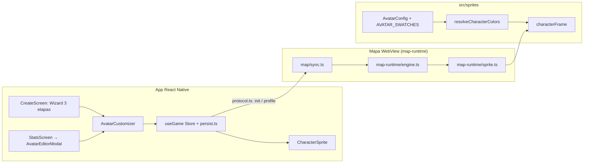

# 002 — Customização de Avatar e Onboarding em Etapas

- **Status:** Implementado
- **Data:** 2026-11-20
- **Relacionado:** [ADR 002 — Modelo de customização de avatar](../decisions/002-avatar-customization-model.md)

## Objetivo

Permitir que o jogador personalize seu avatar em pixel art — escolhendo **estilo de cabelo** (`short`, `pony`, `puff`) e **cores de cada parte** (pele, cabelo, camisa, shorts, tênis, capacete e bike) — durante um novo **onboarding em 3 etapas** (`CreateScreen`) e também a qualquer momento depois, pela tela de perfil (`StatsScreen`).

## Não-objetivos (Próximos Passos)

> **Fora de escopo nesta entrega (planejado para o futuro):**
> - **Loja de customizações** com itens desbloqueáveis/compráveis com moedas, incluindo:
>   - Chapéus e acessórios de cabeça (**hats**)
>   - Óculos (**glasses**)
>   - Modelos/quadros extras de bicicleta (**bikes**)
>   - Modelos de tênis (**shoes**)
>   - Mascotes/companheiros (**pets**)
> - Editor livre de cores (seletor RGB/HSV arbitrário): nesta versão, o jogador escolhe entre paletas curadas de pixel art 16-bit.
> - Migração ou remoção do campo legado `unlocked` no save (mantido para compatibilidade com saves existentes).

## Arquitetura

O motor de sprites (`src/sprites/characters.ts`) já compõe personagens a partir de camadas de pixel art (cabeça, capacete, corpo/bike) e uma paleta semântica (`skin`, `hair`, `top`, `bottom`, `shoe`, `helmet`, `bike` e suas sombras/luzes). A customização estende esse modelo sem novos assets binários e sincroniza o avatar entre o app React Native e o mapa WebView (MapLibre).



## Modelo de Dados

### `src/sprites/avatar.ts`
Módulo puro (sem dependências de React Native, compartilhado com `map-runtime/`):

- `AvatarColors`: 7 cores hex primárias (`skin`, `hair`, `top`, `bottom`, `shoe`, `helmet`, `bike`).
- `AvatarConfig`: `{ hair: HairStyle; colors: AvatarColors }`.
- `AVATAR_SWATCHES`: paletas curadas em estilo 16-bit para cada parte, contendo `{ id, name, color, shade?, light? }`. Todas as cores dos 6 heróis originais (`lia`, `teo`, `dandara`, `kenji`, `maya`, `zeca`) estão incluídas.
- `resolveCharacterColors(colors)`: resolve as variantes de sombra (`*Shade`) e brilho (`hairLight`) a partir das paletas curadas, com fallback algorítmico determinístico caso chegue um hex arbitrário.
- `avatarFromCharacter(characterId)`: converte qualquer preset clássico em `AvatarConfig` (usado nos templates rápidos e na compatibilidade retroativa com saves antigos).
- `resolveAvatar(profile)`: retorna `profile.avatar ?? avatarFromCharacter(profile.characterId)`.
- `avatarKey(avatar)`: chave compacta determinística para cache de rasters.
- `randomAvatar()`: gera uma combinação aleatória a partir das paletas curadas.

### `Profile` (`src/game/types.ts`)
```ts
export interface Profile {
  name: string;
  characterId: string;
  avatar?: AvatarConfig;
  modality: Modality;
  createdAt: number;
}
```
O campo `avatar` é opcional para manter compatibilidade total com `save:v1`.

## Fluxo de Interface

### 1. Onboarding em 3 Etapas (`src/ui/screens/CreateScreen.tsx`)
Indicador de progresso no topo (`1 · Modalidade`, `2 · Avatar`, `3 · Apelido`):
1. **Etapa 1 — Modalidade (`COMO VOCÊ VAI EXPLORAR?`):**
   - Prévia animada do avatar na plataforma reagindo à modalidade escolhida.
   - Cartões `Ciclismo` e `Corrida`.
   - Botão `PRÓXIMO`.
2. **Etapa 2 — Avatar (`MONTE SEU AVATAR`):**
   - Componente reutilizável `<AvatarCustomizer />`.
   - Navegação `Voltar` e `PRÓXIMO`.
3. **Etapa 3 — Apelido (`COMO TE CHAMAM?`):**
   - Resumo compacto com o avatar personalizado animado e chip da modalidade.
   - Campo de apelido (`maxLength={18}`) com ajuste de teclado (`KeyboardAvoidingView`).
   - Navegação `Voltar` e `COMEÇAR AVENTURA`.

### 2. Customizador Reutilizável (`src/ui/components/AvatarCustomizer.tsx`)
- **Palco de prévia:** `HeroPlatform` + `CharacterSprite` animado (`width={120}`), botões de rotação (`down → right → up → left`) e alternador rápido de prévia (`Bike` / `Corrida`). Ao selecionar as abas `Capacete` ou `Bike`, a prévia alterna automaticamente para `bike` para tornar a edição visível.
- **Modelos rápidos:** chips com os 6 presets clássicos (todos gratuitos como ponto de partida) + botão `Aleatório`.
- **Abas de partes:** `Cabelo`, `Pele`, `Camisa`, `Shorts`, `Tênis`, `Capacete`, `Bike`.
- **Controles:** na aba `Cabelo`, seletor de estilo (`Curto`, `Rabo`, `Black`) + grade de cores; nas demais abas, grade de cores curadas com destaque dourado na seleção.

### 3. Edição Pós-Onboarding (`StatsScreen.tsx` + `Modals.tsx`)
- Em `StatsScreen`, o botão `"Trocar herói"` vira `"Editar avatar"`, abrindo `{ type: 'avatar' }`.
- `AvatarEditorModal` encapsula o mesmo `<AvatarCustomizer />` com rascunho local e botões `Cancelar` / `Salvar`.

## Sincronização com o Mapa e Cache
- `src/bridge/protocol.ts`: mensagens `init` e `profile` passam a carregar `avatar?: AvatarConfig`.
- `src/map/sync.ts`: detecta mudanças em `profile.avatar` e reenvia `profile` ao mapa imediatamente.
- `map-runtime/engine.ts` e `map-runtime/sprite.ts`: renderizam e cacheiam quadros por `avatarKey(avatar)` com limite de tamanho no cache (evitando crescimento ilimitado durante a customização).
- `src/ui/rasterImage.ts`: aplica limite de entradas em `rasterCache` e `uriCache`.

## Verificação
- `npm run build:map`
- `npm run typecheck`
- `npm run lint`
- `npm run sprites`
- Teste manual do wizard de 3 etapas, persistência após recarregar, renderização no HUD/Mapa/Stats e edição pelo modal `Editar avatar`.
