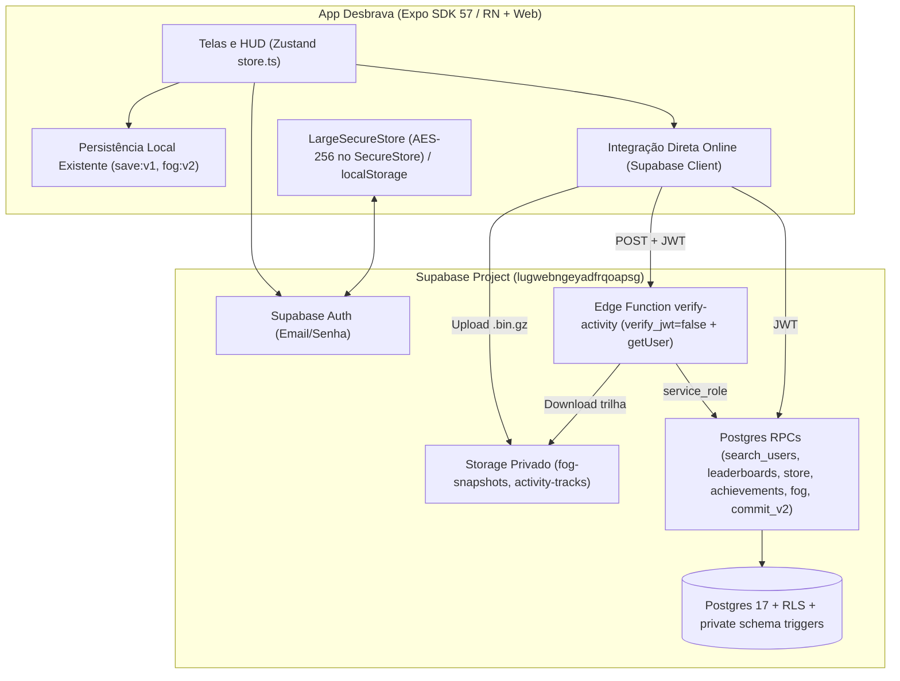

# 003 — Backend no Supabase, Autenticação, Social, Loja e Sincronização Online

- **Status:** Em implementação (Fase M1 — Backend e Design Doc entregues; escopo atualizado em 2026-11-21)
- **Data:** 2026-11-20 (revisado em 2026-11-21)
- **Projeto Supabase:** `lugwebngeyadfrqoapsg` (`eu-west-1`, PostgreSQL 17.12)
- **Relacionado:** [ADR 003 — Backend no Supabase, Autenticação, Social, Loja e Sincronização Offline-First](../decisions/003-supabase-backend-and-offline-sync.md)

---

## 1. Objetivo e Escopo

Especificar e entregar a infraestrutura completa de backend, segurança, armazenamento e contratos de API no Supabase para o **Desbrava** (iOS, Android e Web), com integração direta online e persistência local intacta:

1. **Fase 1 (Auth + Sync Online & Verificação):** Modo Convidado local, autenticação com **Email/Senha**, sessão persistente (`LargeSecureStore` no nativo / `localStorage` na Web), migração local → nuvem, sincronização direta online da névoa (`fog:v2` + `revision`) e verificação autoritativa via Edge Function `verify-activity`.
2. **Fase 2 (Social & Ranking de Amigos):** Busca de usuários públicos (`pg_trgm`), deep links `desbrava://add/<username>`, amizades mútuas (`pending`/`accepted`/`blocked`) com resumo privado seguro e ranking entre amigos.
3. **Fase 3 (Loja, Cosméticos & Boosters):** Catálogo `store_items`, compra atômica via RPC `purchase_store_item`, cosméticos permanentes em camadas pixel-art e ativação online de boosters (`user_boost_usages`) reconciliada na `verify-activity`.
4. **Fase 4 (Ranking Global):** Rankings globais All-Time (índices de cobertura em `profiles WHERE is_public = true`) e Mensais (`activities` ao vivo verificadas no fuso `America/Sao_Paulo`).

### Recursos Adiados (Fora do Escopo Atual — 2026-11-21)

- **Sincronização offline via fila e caches:** `sync:outbox`, caches locais (`cache:friends`, `cache:leaderboard`, `cache:store`, `cache:inventory`) e reconciliação offline de boosters ficam **adiados (fora do escopo atual)** — o cliente mantém a persistência local existente e integra diretamente online com o Supabase quando autenticado.
- **Provedores OAuth Apple e Google:** Sign in with Apple (`expo-apple-authentication`) e Google Sign-In (`@react-native-google-signin/google-signin`, `expo-auth-session`, `expo-web-browser`) ficam **adiados (fora do escopo atual)** — o escopo atual utiliza apenas Email/Senha e Modo Convidado.

### Não-objetivos

- Editar manualmente os diretórios gerados `ios/` e `android/` (toda configuração nativa é feita via `app.json` e config plugins do Expo CNG).
- Armazenar células individuais da névoa ou pontos GPS linha a linha no Postgres (mantidos em blobs binários comprimidos no Supabase Storage).
- Expor `SUPABASE_SERVICE_ROLE_KEY` ou chaves secretas no código do aplicativo cliente.
- Compartilhar trilhas GPS, histórico de atividades individuais ou coordenadas exatas com amigos ou público.

---

## 2. Arquitetura Geral

---

## 3. Modelo de Dados (Postgres 17 + `pg_trgm`)

As migrações residem em `supabase/migrations/`:

- `0001_extensions_and_core_tables.sql` — extensões (`pg_trgm` no schema `extensions`), schema `private` (funções internas `set_updated_at()` e `level_from_xp()`), 11 tabelas principais e índices.
- `0002_auth_trigger_and_rls.sql` — trigger `on_auth_user_created` (`private.handle_new_user`), proteção de colunas (`private.protect_profile_columns`), máquina de estados de amizades (`private.protect_friendships_transitions`), privilégios mínimos e RLS nas 11 tabelas.
- `0003_storage_buckets.sql` — buckets privados `fog-snapshots` (10 MiB) e `activity-tracks` (5 MiB) e políticas em `storage.objects`.
- `0004_rpcs.sql` — 9 funções RPC (`search_users`, `get_public_profile`, `get_public_profile_by_username`, `get_friends_leaderboard`, `get_global_leaderboard`, `purchase_store_item`, `claim_achievement`, `upsert_fog_state`, `commit_verified_activity`).
- `0005_seed_store_items.sql` — catálogo inicial da loja (16 cosméticos e 3 boosters consumíveis em pt-BR).
- `0006_service_role_private_grants.sql` — `GRANT USAGE ON SCHEMA private` e `GRANT EXECUTE ON FUNCTION private.level_from_xp(integer)` exclusivamente para `service_role`.
- `0007_security_hardening_and_index_fix.sql` — hardening pós-auditoria: coluna `user_captures.is_verified` protegida por coluna + trigger, validação canônica e baseada em atividades verificadas no `claim_achievement`, teto de células verificadas no `upsert_fog_state`, nova `commit_verified_activity_v2` com cálculo atômico de boosters (revogando `commit_verified_activity` v1) e ramificação por métrica no `get_global_leaderboard`.
- `0008_protect_verified_captures_and_city_pct.sql` — proteção de linhas verificadas em `user_captures` contra `UPDATE` do cliente (`protect_user_captures_columns` rejeita `OLD.is_verified = true` com `42501` e `ALTER POLICY user_captures_update_own` restringe a `is_verified = false`), cálculo autoritativo de `city_pct` em `claim_achievement` (células verificadas por cidade, `cell_area_m2` derivado da latitude do `bbox` e piso de área `>= 15%` do `bbox` e `>= 1 km²`) e `IS DISTINCT FROM` na checagem de `p_expected_revision` do `upsert_fog_state`.

### Resumo das 11 Tabelas em `public`

| Tabela | Chave Primária | Responsabilidade | Escrita pelo Cliente (`authenticated`) |
|---|---|---|---|
| `profiles` | `id (uuid)` | Perfil, avatar, privacidade e totais oficiais | Apenas colunas cosméticas (`username`, `display_name`, `modality`, `character_id`, `avatar_config`, `is_public`, `settings`, `updated_at`) |
| `activities` | `(user_id, id)` | Histórico ilimitado (`live` \| `gpx_import`) e status (`pending` \| `verified` \| `flagged`) | Bloqueada (exclusiva via `commit_verified_activity_v2` / `service_role`) |
| `user_cities` | `(user_id, city_id)` | Progresso por município (`area_m2`, `bbox`, `cells`) | `SELECT`, `INSERT`, `UPDATE` do próprio dono (conquistas exigem atividade verificada) |
| `user_captures` | `(user_id, poi_id)` | POIs capturados (`is_verified` gerenciado pelo servidor) | `SELECT`, `INSERT`/`UPDATE` apenas enquanto `is_verified = false` (`private.protect_user_captures_columns` força `is_verified = false` e bloqueia `UPDATE` em linhas verificadas) |
| `user_achievements` | `(user_id, achievement_key)` | Conquistas resgatadas e moedas concedidas | Bloqueada (exclusiva via RPC `claim_achievement`) |
| `user_fog_state` | `user_id` | Metadados do snapshot binário (`storage_path`, `cell_count`, `revision`) | Bloqueada (exclusiva via RPC `upsert_fog_state`) |
| `friendships` | `id (uuid)` | Relações `pending` / `accepted` / `blocked` + `blocked_by` | `SELECT`/`INSERT`/`UPDATE`/`DELETE` entre as partes com trigger de transição |
| `store_items` | `id (text)` | Catálogo de cosméticos e consumíveis | Somente leitura (`anon` e `authenticated`) |
| `user_inventory` | `(user_id, item_id)` | Quantidade possuída de cada item | Bloqueada (escrita via `purchase_store_item` e `commit_verified_activity_v2`) |
| `user_boost_usages` | `id (text)` | Registro idempotente de ativação online de boosters | `SELECT` e `INSERT` com `consumed_at IS NULL` |
| `wallet_ledger` | `id (uuid)` | Extrato append-only (`UNIQUE (user_id, reason, ref_id)`) | Bloqueada (escrita exclusiva do servidor) |

### Índices Principais

- **Busca (`pg_trgm` em `extensions`):** `idx_profiles_username_trgm` e `idx_profiles_display_name_trgm` com `extensions.gin_trgm_ops` restritos a `WHERE is_public = true`.
- **Ranking Global All-Time (covering indexes):** `idx_profiles_global_xp`, `idx_profiles_global_distance`, `idx_profiles_global_cells` (`WHERE is_public = true`) incluindo `username, display_name, level, character_id, avatar_config, modality`.
- **Ranking Mensal Competitivo:** `idx_activities_verified_monthly_global` em `(started_at, user_id) INCLUDE (xp, distance_m, new_cells) WHERE verification_status = 'verified' AND source = 'live'`.
- **Capturas Verificadas:** `idx_user_captures_user_verified_cat_rarity` em `(user_id, category, rarity) WHERE is_verified = true`.
- **Amizades:** índice único não-direcionado `idx_friendships_pair_unique` em `(LEAST(requester_id, addressee_id), GREATEST(requester_id, addressee_id))`, além de índices em `(requester_id, status)`, `(addressee_id, status)` e `(blocked_by)`.

---

## 4. Segurança, RLS e Isolamento de Dados

Todas as 11 tabelas possuem `ENABLE ROW LEVEL SECURITY`, uso obrigatório de `(select auth.uid())` e cláusulas explícitas `TO authenticated` (ou `TO anon, authenticated` apenas em `store_items`), evitando `auth.role()` e qualquer `SECURITY DEFINER` view.

### Proteção de `profiles` e Criação Automática

- **Cadastro automático (`private.handle_new_user`):** Trigger `AFTER INSERT ON auth.users` cria automaticamente a linha em `public.profiles` com `xp = 0`, `level = 1`, `wallet = 0`, `display_name` derivado do metadata (fallback `'Viajante'`) e `username` único normalizado (`^[a-z0-9_]{3,24}$`).
- **Proteção em nível de coluna (duas camadas):**
  1. `REVOKE INSERT, UPDATE, DELETE ON public.profiles FROM PUBLIC, anon, authenticated;` seguido de `GRANT INSERT (...)` e `GRANT UPDATE (username, display_name, modality, character_id, avatar_config, is_public, settings, updated_at)` — qualquer `UPDATE` direto em `xp`, `level`, `wallet`, `total_*` ou `achievements_count` falha na camada de privilégios (`42501`).
  2. Trigger `BEFORE INSERT OR UPDATE` (`private.protect_profile_columns`) força zeros iniciais em `INSERT` direto de cliente e lança erro `42501` se qualquer coluna gerenciada pelo servidor mudar em `UPDATE` direto de `anon`/`authenticated`.
- **Isolamento de privacidade:** A policy `profiles_select_own` restringe `SELECT` em `public.profiles` apenas a `(select auth.uid()) = id`. Leituras de outros jogadores ocorrem exclusivamente via RPCs (`search_users`, `get_public_profile`, `get_public_profile_by_username`, `get_friends_leaderboard`, `get_global_leaderboard`), garantindo que `wallet`, `settings`, `activities`, `user_captures`, `activity-tracks` e `fog-snapshots` jamais sejam expostos a terceiros.
- **Proteção de `user_captures.is_verified`:** O cliente possui `GRANT INSERT`/`UPDATE` apenas nas colunas descritivas (excluindo `is_verified`), a policy `user_captures_update_own` restringe `UPDATE` a linhas não verificadas (`is_verified = false`), e o trigger `BEFORE INSERT OR UPDATE` (`private.protect_user_captures_columns`) força `NEW.is_verified := false` para `anon`/`authenticated` além de rejeitar qualquer `UPDATE` de cliente quando `OLD.is_verified = true` (`42501`). Somente `commit_verified_activity_v2` (`service_role`) grava ou promove capturas para `is_verified = true`.

### Máquina de Estados de `friendships`

A coluna `blocked_by` combinada com `private.protect_friendships_transitions()` e as políticas de `friendships` impede que o usuário bloqueado remova ou altere o bloqueio (`DELETE`/`UPDATE` em linhas `status = 'blocked'` só são permitidos quando `blocked_by = auth.uid()`).

---

## 5. Storage Buckets Privados

Dois buckets privados (`public = false`) configurados em `0003_storage_buckets.sql`:

- `fog-snapshots` — limite `10 MiB`, MIME `application/octet-stream`, `application/gzip`, `application/x-gzip`. Caminho: `{user_id}/fog.bin.gz` (ou `fog.bin`).
- `activity-tracks` — limite `5 MiB`, mesmos tipos MIME. Caminho: `{user_id}/{activity_id}.bin.gz`.

Políticas em `storage.objects` concedem `SELECT`, `INSERT`, `UPDATE` e `DELETE` a `authenticated` apenas quando `(storage.foldername(name))[1] = (select auth.uid()::text)` (a combinação `SELECT + INSERT + UPDATE` é obrigatória para suportar `upsert: true`).

---

## 6. Contrato das Funções RPC

Todas as RPCs voltadas ao cliente usam `SECURITY DEFINER`, `SET search_path = public, [extensions,] pg_temp`, `REVOKE ALL ... FROM PUBLIC, anon`, `GRANT EXECUTE ... TO authenticated` e validação `IF auth.uid() IS NULL THEN RAISE EXCEPTION ...`. Apenas `commit_verified_activity_v2` usa `SECURITY INVOKER` e é restrita a `service_role` (a assinatura legada `commit_verified_activity` tem `EXECUTE` revogado inclusive de `service_role` na migração `0007`).

1. **`search_users(p_query text, p_limit int default 20)`**
   - Normaliza `@` inicial, exige `>= 2` caracteres, exclui o próprio usuário e relações `'blocked'`, busca em `is_public = true` usando `ILIKE` + operador trigram `%` e retorna resumo público + `friendship_status` e `friendship_direction`.
2. **`get_public_profile(p_user_id uuid)` & `get_public_profile_by_username(p_username text)`**
   - Retorna resumo completo do perfil (incluindo `total_moving_s`, `total_activities`, `total_captures`, `achievements_count`) se o alvo for o próprio usuário, público (`is_public = true`) ou amigo `accepted` (sempre omitindo `wallet` e `settings`).
3. **`get_friends_leaderboard(p_metric text, p_period text)`**
   - `p_metric` ∈ `('xp', 'distance', 'cells')`, `p_period` ∈ `('all_time', 'monthly')`.
   - `all_time` lê de `profiles`; `monthly` agrega `activities` com `verification_status = 'verified' AND source = 'live'` dentro do mês corrente em `America/Sao_Paulo`.
4. **`get_global_leaderboard(p_metric text, p_period text, p_limit int default 50, p_offset int default 0)`**
   - Retorna `{ entries, my_rank }` sobre `profiles WHERE is_public = true` (`all_time`, com ramificação explícita `IF / ELSIF / ELSE` por métrica para uso direto dos índices parciais `idx_profiles_global_*`) e sobre `activities` verificadas ao vivo (`verification_status = 'verified' AND source = 'live'`) no mês corrente em `America/Sao_Paulo` (`monthly`).
5. **`purchase_store_item(p_item_id text, p_quantity int default 1)`**
   - Lock em ordem fixa (`profiles FOR UPDATE` → `user_inventory FOR UPDATE`), valida item ativo, limite de `max_stack` e `wallet >= total_price`, debita `profiles.wallet`, registra `-total_price` em `wallet_ledger` (`reason = 'store_purchase'`) e incrementa `user_inventory`.
6. **`claim_achievement(p_achievement_key text)`**
   - Exige formato canônico estrito (`^(0|[1-9][0-9]*)$` para índice de tier e `^[0-9]{4}-(0[1-9]|1[0-2])$` para mês), reconstrói `v_canonical_key` para idempotência e `wallet_ledger.ref_id`, trava `profiles FOR UPDATE` e valida contra dados verificados (`user_captures.is_verified = true` para `poi_categories`/`rare_captures`; para `cities_count`/`city_pct`, exige `user_cities` com `cells > 0`, `area_m2 >= 10000`, `cell_area_m2 BETWEEN 1 AND 400`, atividade `verified` contendo `city_id = ANY(a.city_ids)`, e em `city_pct` limita células a `LEAST(uc.cells, profiles.total_cells, SUM(a.new_cells) daquela cidade)`, valida `bbox = [w,s,e,n]` dentro dos limites Web Mercator, recalcula `cell_area_m2` no servidor pela latitude média do `bbox` e aplica piso de área `GREATEST(uc.area_m2, bbox_area_m2 * 0.15, 1000000.0)`), inserindo `user_achievements` + `wallet_ledger` e atualizando `profiles.wallet` e `achievements_count`.
7. **`upsert_fog_state(p_storage_path text, p_cell_count int, p_expected_revision bigint default 0)`**
   - Lock `profiles FOR UPDATE` → `user_fog_state FOR UPDATE`. Valida caminho `{auth.uid()}/fog.bin(.gz)`, aplica controle otimista em `revision` com `IS DISTINCT FROM` (inclusive quando `p_expected_revision` é `NULL`, retornando `{ conflict: true, ... }`) e limita `cell_count` e `profiles.total_cells` a `LEAST(p_cell_count, COALESCE(SUM(activities.new_cells) WHERE verification_status = 'verified', 0))`, retornando também `total_cells`.
8. **`commit_verified_activity_v2(...)`**
   - `SECURITY INVOKER`, `GRANT EXECUTE ... TO service_role`. Lock `profiles FOR UPDATE`, checa idempotência em `activities(user_id, id)`, recebe valores base (`p_base_xp`, `p_base_coins`, `p_new_cells`, `p_fog_multiplier`) e `p_boost_usage_ids`, trava `user_boost_usages` (`consumed_at IS NULL`) e `user_inventory` (`quantity > 0`) `FOR UPDATE`, consome no máximo 1 booster por categoria (`boost_xp`, `boost_fog`, `boost_coins`), aplica multiplicadores **somente** para os boosters efetivamente consumidos na transação (ou reescala `new_cells` se `boost_fog` não foi consumido), grava `activities`, insere/promove `user_captures` com `is_verified = true`, lança `wallet_ledger` (`activity_coins`), recalcula `level` via `private.level_from_xp`, atualiza `profiles` mantendo `total_cells <= SUM(activities.new_cells) WHERE verification_status = 'verified'` e retorna `activity`, `authoritative` e `consumed_boost_usage_ids`.

---

## 7. Contrato da Edge Function `verify-activity`

Configurada em `supabase/config.toml` com `verify_jwt = false` (para compatibilidade com chaves `sb_publishable_...` e JWTs de sessão) e implementada em `supabase/functions/verify-activity/{deno.json, gameMath.ts, validator.ts, index.ts}`.

- **Autenticação:** Extrai `Bearer <access_token>` e valida via `supabaseAdmin.auth.getUser(token)` (`401` se inválido/ausente). Valida prefixo `trackPath.startsWith(`${user.id}/`)` (`403` se violado).
- **Descompressão segura:** Verifica assinatura gzip (`0x1f 0x8b`), descomprime via `DecompressionStream('gzip')` com limite máximo de `24 MiB` (`413` se exceder) e valida múltiplos de 24 bytes (`Float64Array` `[lng, lat, t]`).
- **Payload (`POST`):**
  - `activityId`, `source` (`'live' | 'gpx_import'`), `modality` (`'bike' | 'run'`), `startedAt`, `endedAt`, `trackPath`, `clientSummary` (`distanceM`, `movingS`, `maxSpeed`, `newCells`, `coinsCount`, `coinsValue` validados como números finitos não-negativos; `coinsByKind?`, `captures?`, `cityIds?`), `boostUsageIds?`.
  - `cityIds` é saneado (sem duplicatas/espaços) e limitado a `Math.min(12, Math.max(3, Math.ceil(distanceM / 5000) + 2))`.
- **Resposta (`200`):**
  - `{ status: 'verified' | 'flagged', reason?, activity: { id, verificationStatus, distanceM, movingS, maxSpeed, xpEarned, coinsEarned, newCells }, authoritative: { xp, level, wallet, totalDistanceM, totalMovingS, totalActivities, totalCells, totalCaptures, achievementsCount } }`.
- **Regras de paridade e anti-cheat (`validator.ts` e `gameMath.ts`):**
  - Espelha `src/game/config.ts`, `geo.ts`, `progression.ts`, `fog.ts`, `tracker.ts`, `gpxImport.ts`, `pois.ts` e `src/sprites/items.ts` (incluindo `pointToSegmentDistanceM` em projeção `toMerc`).
  - Limite polar Web Mercator: `|lat| <= 85.05112878` (e guarda em `cellsInRadius` com `size >= 0.01` e `r <= 1024`), evitando travamento de CPU em latitudes polares.
  - XP de moedas: `Math.max(1, Math.ceil(COIN_VALUE[kind] * 0.5))` por unidade (`bronze: 1`, `silver: 3`, `gold: 10`, `gem: 50`).
  - `gpx_import`: ignora saltos `> 500 m`, valida `newCells` finito não-negativo, força `xpEarned = 0`, `coinsEarned = 0`, `validCaptures = []`.
  - `live`: flaga (`verification_status = 'flagged'`, `0` créditos) em coordenadas/timestamps inválidos ou não-monotônicos, saltos de teleporte (`d > 250 m` com `speed > MAX_SPEED * 1.5` ou `d > 1000 m` em `dt <= 30 s`), picos impossíveis (`d > 50 m` com `speed > MAX_SPEED * 1.5` ou `d > 15 m` com `speed > MAX_SPEED * 2.0`), excesso sustentado (`> 20%` dos segmentos/distância acima de `MAX_SPEED * 1.15` ou média `distanceM / activeDurationS > MAX_SPEED * 1.05` com `activeDurationS >= 30 s`, usando duração ativa sem teto de 30s para não punir lacunas legítimas de GPS), divergência exagerada em `distanceM` / `newCells`, farm estacionário (`distanceM < 25` ou `n < 2`: máximo `3` moedas, `coinsValue <= 25`, `0` gemas) ou excesso de gemas (`> Math.max(1, maxSpawns)`), capturas duplicadas (normalizando `poiId.trim()` antes de `seenPoiIds`) ou capturas fora do raio `POI_INFO[cat].radius + 100 m`. Envios base (`baseXp`, `baseCoins`, `fogMultiplier`) são reconciliados atomicamente dentro de `commit_verified_activity_v2`.

---

## 8. Autenticação, Sessão Persistente, Migração e Deep Links

- **Dependências (Expo SDK 57):** `@supabase/supabase-js`, `expo-secure-store`, `expo-crypto`, `expo-linking`. *(Adiados / fora do escopo atual: `expo-apple-authentication`, `@react-native-google-signin/google-signin`, `expo-auth-session`, `expo-web-browser`, `expo-network`.)*
- **`app.json`:** plugin `expo-secure-store` (`configureAndroidBackup: true`), sem entitlements de Apple Sign-In nem URL schemes de Google OAuth.
- **Autenticação no escopo atual:** Modo Convidado local + **Email/Senha** (`signInWithPassword` / `signUp` / recuperação). Sign in with Apple e Google Sign-In estão **adiados (fora do escopo atual)**.
- **`LargeSecureStore`:** Como o JSON de sessão do Supabase (~2,5–4 KB) pode exceder o limite histórico de ~2048 bytes no Keychain/SecureStore do iOS, a camada nativa armazena apenas a chave AES-256 no `expo-secure-store` e grava o payload criptografado no KV local; na Web utiliza `localStorage`.
- **Migração Local → Nuvem:** Conta na nuvem vazia faz merge automático; conta na nuvem com progresso prévio exibe diálogo (`Mesclar` vs `Manter apenas a nuvem`).
- **Logout seguro:** Limpa o estado local (`wipeAll()`) e executa `signOut()` mantendo integridade dos dados autenticados na nuvem.
- **Deep links:** Esquema `desbrava://add/<username>` e URL Web equivalente para convite direto de amizade.

---

## 9. Loja, Cosméticos e Sincronização Online

- **Integração direta online:** Atividades, névoa (`fog:v2` com controle otimista por `revision` e união de conjuntos *Grow-Only Set* remapeando `cityIds`), capturas, conquistas, compras na loja (`purchase_store_item`) e ativação online de boosters (`user_boost_usages`) são sincronizados diretamente com o Supabase quando o usuário está autenticado, mantendo a persistência local existente intacta.
- **Itens adiados (fora do escopo atual):** fila durável `sync:outbox`, caches locais (`cache:friends`, `cache:leaderboard`, `cache:store`, `cache:inventory`) e ativação/reconciliação offline de boosters ficam **adiados (fora do escopo atual)**. *(O backend mantém o contrato completo de `user_boost_usages` e `commit_verified_activity_v2` pronto para uso online imediato ou futuro uso offline.)*

---

## 10. Decisões Detalhadas (Resolução de Ambiguidades)

| # | Ambiguidade (Survey 1) | Decisão Adotada no Design e Schema |
|---|---|---|
| 1 | Proteção em nível de coluna em `profiles` | Duas camadas: `REVOKE UPDATE` + `GRANT UPDATE` apenas em colunas cosméticas/perfil, somado ao trigger `BEFORE INSERT OR UPDATE` (`private.protect_profile_columns`) bloqueando mutações diretas em `xp`, `level`, `wallet`, `total_*` e `achievements_count`. |
| 2 | Fronteira de privacidade de perfis públicos e amigos | `profiles` `SELECT` é estritamente dono-único (`auth.uid() = id`). Leituras entre jogadores usam apenas RPCs `SECURITY DEFINER` que nunca expõem `wallet`, `settings`, `activities`, `user_captures`, `activity-tracks` ou `fog-snapshots`. |
| 3 | Validação e crédito de `user_achievements` | Escrita direta pelo cliente bloqueada. A RPC `claim_achievement` exige chave canônica estrita, valida elegibilidade contra as regras de `src/game/achievements.ts` usando apenas `user_captures.is_verified = true` e `user_cities` corroboradas por atividades verificadas (e limitadas a `profiles.total_cells`), grava `user_achievements` + `wallet_ledger` idempotente e credita `profiles.wallet` e `achievements_count`. |
| 4 | Limiares exatos da `verify-activity` | Paridade 1:1 com `config.ts`/`geo.ts`/`progression.ts`/`items.ts` (com guarda polar `\|lat\| <= 85.05112878`), XP de moeda `Math.max(1, Math.ceil(val * 0.5))`, `gpx_import` sem XP/moedas/capturas, limiares de teleporte/velocidade sustentada (com `activeDurationS` sem teto de 30s), limite anti-farm de moedas/gemas e aplicação atômica de multiplicadores de boosters exclusivamente dentro de `commit_verified_activity_v2` após lock `FOR UPDATE`. |
| 5 | Fuso horário e GPX nos rankings mensais | Limite mensal calculado em `America/Sao_Paulo`. Rankings mensais (`get_friends_leaderboard` e `get_global_leaderboard`) e `idx_activities_verified_monthly_global` filtram `verification_status = 'verified' AND source = 'live'`, impedindo que GPX históricos distorçam competições mensais. |
| 6 | Escopo de cosméticos da Loja | `AvatarConfig` e `MapProfile` serão estendidos com `equipped?: { hat?, glasses?, bike?, shoe?, pet?, color? }` em pixel art (`src/sprites/` + `map-runtime/`). Os 6 presets `CHARACTERS` gratuitos de onboarding (Design Doc 002) são preservados; a loja adiciona novos cosméticos e boosters. |
| 7 | Criação inicial do perfil no signup | Trigger `private.handle_new_user` em `auth.users` cria `profiles` com valores zerados e `username` único seguro já no cadastro. O Modo Convidado joga 100% local até o jogador decidir entrar/vincular conta. |

---

## 11. Verificação

- **Estática e build:** `npx expo config --json`, `npm run typecheck`, `npm run lint`, `npm run build:web`.
- **Advisors do Supabase (`lugwebngeyadfrqoapsg`):** `get_advisors` (`security` e `performance`) confirmando `0` `rls_disabled_in_public`, `0` `extension_in_public`, `0` `security_definer_view`, `0` `0028_anon_security_definer_function_executable` em RPCs do projeto e `0` chaves estrangeiras sem índice.
- **Testes automatizados ao vivo:** `node --disable-warning=MODULE_TYPELESS_PACKAGE_JSON --test scripts/verify-supabase-backend.ts` validando fronteira anônima, RLS de colunas/tabelas, isolamento entre usuários no Postgres e Storage, paridade da `verify-activity` + idempotência + GPX + anti-cheat (incluindo `poiId` com espaços duplicados, latitude polar `90`, lacuna GPS `dt = 80s`, farm estacionário `0m` de 52 gemas e falha de booster esgotado), compra atômica + consumo de booster, social/bloqueio, `upsert_fog_state` (com teto de células verificadas) e `claim_achievement` (rejeição de chaves não-canônicas, `user_cities` falsas e `user_captures` não-verificadas).
- **Política anti-bounce em testes ao vivo (obrigatório):** **NUNCA** chamar `supabase.auth.signUp()`, `resetPasswordForEmail()` ou `resend()` com endereços de e-mail fictícios/inexistentes contra o projeto `lugwebngeyadfrqoapsg`, pois o envio real gera bounces que podem suspender o serviço de e-mail do projeto. Suítes de teste devem usar exclusivamente contas pré-confirmadas (`TEST_USER_A_*`/`TEST_USER_B_*` via `signInWithPassword`) ou `supabase.auth.admin.createUser({ email_confirm: true })` (ou provisionamento direto em Postgres em `auth.users` + `auth.identities` com `email_confirmed_at = now()`).
